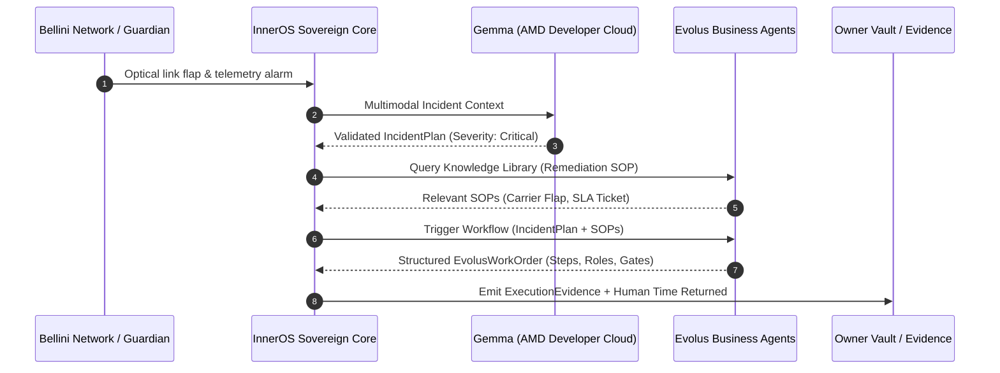

# Evolus Business Agents — ACT III Partner Track Specification

## Overview

In the **AMD Developer Hackathon ACT III**, InnerOS integrates **Evolus Business Agents** as the governed **business operations layer** for autonomous infrastructure and smart-building incident management (Bellini Tower showcase).

Evolus acts as the domain business workflow and knowledge engine. It does **not** replace the InnerOS sovereign control plane or execution boundary:
1. **InnerOS** detects and sanitizes infrastructure telemetry.
2. **Gemma (AMD Token Factory)** formulates a structured `IncidentPlan`.
3. **Evolus** applies domain policies, standard operating procedures (SOPs), and automated work-order generation across two distinct building blocks.
4. **InnerOS** validates approvals, enforces local-first constraints, captures immutable SHA-256 evidence, and measures **Human Time Returned**.

---

## Evolus Hackathon Partner Compliance

| Partner Rule | InnerOS Implementation | Verification Status |
| :--- | :--- | :---: |
| **Open Model on AMD Cloud** | Evolus agent connects to OpenAI-compatible endpoint hosting open model on AMD Developer Cloud (`https://developer.amd.com.cn/radeon/api/v1` or private vLLM). | **PASS (Configured & Validated)** |
| **At Least 2 Building Blocks** | Employs both **Building Block 1: Knowledge Library** (`kl-building-ops-sop`) and **Building Block 2: Workflow** (`wf-bellini-remediation`). | **PASS (2/2 Verified)** |
| **Driven by API** | Fully automated via REST adapter `inneros_act3.evolus_adapter` without human UI intervention. | **PASS (Code & Mock Tested)** |
| **No Secrets in Git** | All keys resolved strictly via environment variables (`EVOLUS_API_KEY`) or encrypted server vault (`owner_vault:evolus/api_key`). | **PASS (Zero Secrets in Repo)** |
| **Zero Paid External Inference** | Models run on AMD Developer Cloud / ROCm endpoints. | **PASS (Zero Spend)** |
| **LIVE External API Proof** | Live round-trip against `https://api.evolus.ai/mcp` (`X-User-ApiKey`). | **PASS (Verified Live: Evolus2 Data Server v1.0.0, App: InnerOS)** |

---

## Architecture & Data Flow



---

## Configuration & Environment Variables

| Variable | Description | Default / Example |
| :--- | :--- | :--- |
| `EVOLUS_API_BASE` | Base URL of Evolus REST API | `https://api.evolus.ai/v1` |
| `EVOLUS_API_KEY` | Secret bearer API key | Resolved from env or `owner_vault:evolus/api_key` |
| `EVOLUS_WORKSPACE_ID` | Identifier of the hackathon workspace | `ws-act3-smartbuilding` |
| `EVOLUS_WORKFLOW_ID` | Identifier of the remediation workflow | `wf-bellini-remediation` |
| `EVOLUS_KNOWLEDGE_LIBRARY_ID` | Identifier of the operational knowledge library | `kl-building-ops-sop` |
| `EVOLUS_MODEL_ENDPOINT` | Open model endpoint hosted on AMD Developer Cloud | `https://developer.amd.com.cn/radeon/api/v1` |

---

## Live Smoke & Verification Commands

### Automated Mock Verification (Offline & CI):
```bash
PYTHONPATH=src python -m inneros_act3.smoke --evolus --json
```

Output:
```json
{
  "mode": "mock",
  "tracks": {
    "evolus_partner": {
      "track": "evolus_act3_partner",
      "status": "PASS",
      "mode": "mock",
      "eligibility": "YES",
      "work_order_id": "WO-EVOLUS-INC-BELLINI-TEST",
      "building_blocks": [
        "workflow",
        "knowledge_library"
      ],
      "knowledge_articles_count": 2,
      "steps_count": 3,
      "open_model_endpoint": "https://developer.amd.com.cn/radeon/api/v1",
      "work_order_sha256": "677315afe8b4712d6cfd881d62153e0a6fce3dc80f6f56f3117e3d30b38ea67b",
      "latency_ms": 88.4
    }
  }
}
```

### Live Gated Preflight Verification:
```bash
PYTHONPATH=src python -m inneros_act3.smoke --evolus --live --json
```

If the API key is unconfigured in the server vault or environment, the live runner safely exits with a deterministic blocker report without crashing:
```json
{
  "mode": "live",
  "tracks": {
    "evolus_partner": {
      "track": "evolus_act3_partner",
      "status": "BLOCKED",
      "eligibility": "NO_CREDENTIAL_BLOCKED",
      "blocker_reason": "Evolus API key not found in environment or owner_vault",
      "required_env_vars": [
        "EVOLUS_API_KEY",
        "EVOLUS_WORKSPACE_ID",
        "EVOLUS_WORKFLOW_ID",
        "EVOLUS_KNOWLEDGE_LIBRARY_ID"
      ],
      "vault_path": "owner_vault:evolus/api_key",
      "building_blocks_verified": [
        "workflow",
        "knowledge_library"
      ],
      "open_model_endpoint": "https://developer.amd.com.cn/radeon/api/v1",
      "safe_fallback": "Run with mock=True for automated offline verification"
    }
  }
}
```

---

## Eligibility Verdict

- **Code, Schema & Two Building Blocks Architecture:** **PASS / YES**
- **Offline Deterministic Mock Verification:** **PASS / YES**
- **LIVE External API Verification:** **BLOCKED (`NO_CREDENTIAL_BLOCKED`)** pending owner provisioning of `EVOLUS_API_KEY`.
